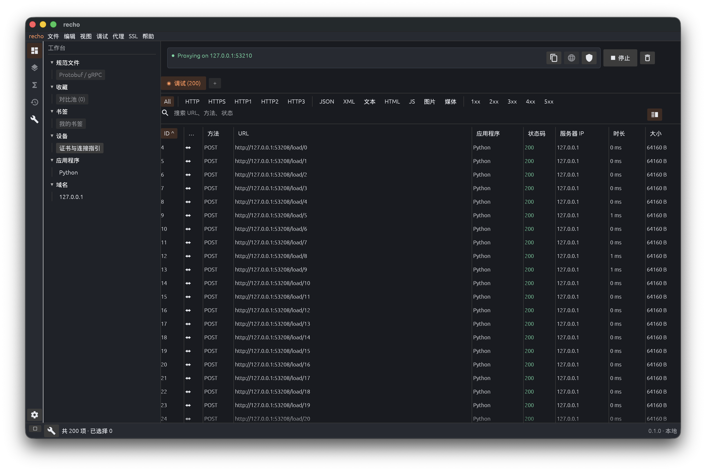

# recho

Windows/macOS 抓包工具的纯 Rust 重写，使用 **egui/eframe** 构建界面，
直接链接 Rust 引擎。无需 Flutter、Dart 或 WebView，无账号和云服务。

界面与操作以 [Respable](https://github.com/jyy2luck/Respable) 的 `a24b1c9` 为参照。引擎以 `762a5902c84f91ec250640c6123c1a5286cd658d` 的独立副本为基础，可单独构建。

- 抓包工作台支持多个独立调试会话、历史分页、HAR 导入导出、无痕模式、条件筛选和高亮。九列表格支持上下键、范围选择和双击详情，正文支持 Raw、JSON、Tree 和 Hex。
- API 编辑器支持 HTTP、原始 HTTP、WebSocket、gRPC 和 Protobuf，保存草稿、集合、环境变量和规范。抓包记录可复制 cURL、加入书签或对比池，也可转到编辑器重发。
- 调试工具支持重写、脚本、请求和响应断点、SSL、访问控制、上游代理、网关、镜像、反向代理和 MCP 配置。
- macOS 使用原生系统菜单，Windows 使用窗口菜单。两个平台均提供代理、证书入口和六种配色。每种配色都有深浅两版，默认使用黑白配色并跟随系统外观。

抓包列表只同步摘要，打开详情时读取正文。列表与长文本使用虚拟滚动，空闲时按事件重绘。
Windows 使用 wgpu/Direct3D 12 渲染，macOS 使用 Glow/OpenGL。



[查看请求与响应详情](research/details.png)

## 构建和运行

需要 Rust 1.95+ 和平台 C/C++ 编译工具。检查还需要 Node.js、Python 3 和 OpenSSL。

```sh
./scripts/build.sh
open app/build/release/recho.app
```

Windows 在 Visual Studio Developer PowerShell 中执行：

```powershell
./scripts/build.ps1
./app/build/release/recho.exe
```

也可直接 `cargo run --release --locked -p recho`。构建缓存及产物统一在 `app/build/`，
macOS app 使用本地 ad-hoc 签名，尚未公证；Windows 尚未签名。

默认数据目录为 macOS `~/Library/Application Support/recho`、Windows `%LOCALAPPDATA%\recho`。
首次运行默认分配随机代理端口，应用固定端口后会记住该选择。窗口顶部显示实际监听地址。
系统代理可在连接设置中手动启用，也可选择以后启动调试时自动启用。
开启 HTTPS 解密后，客户端需单独信任本地 CA，证书信任需要用户确认。

隔离运行示例（macOS）：

```sh
RECHO_DATA_DIR="$(mktemp -d)" RECHO_PROXY_PORT=0 app/build/release/recho
```

`RECHO_DATA_DIR` 必须是绝对路径；`RECHO_PROXY_PORT` 可指定 0–65535。
请为 recho 使用独立目录，不要指向正在运行的 Respable 数据目录。
调试标签保留本轮全部抓包，重启后恢复已落盘的记录。上方垃圾桶或 Ctrl+X 可清空当前标签。普通记录可在 F4 历史按日期查看和删除，无痕记录只保存在内存中，清空后丢弃。
打开调试工具中的 MCP 可查看连接配置和管理访问令牌。

## 验证和范围

```sh
./scripts/check.sh
# Windows: ./scripts/check.ps1
```

详见 [阶段规格](specs/001-rust-desktop.md) 和 [对齐、验证记录](research/VALIDATION.md)。
内存以实际 Release 测量为准，不设固定的 50 MB 门槛。

## 项目设计技能（可选）

当前工作区的花叔 Design 位于 `.agents/skills/huashu-design/`。这套素材和脚本仅用于开发环境。
需要在另一份工作区使用时，可将 [huashu-design](https://github.com/alchaincyf/huashu-design) 安装到同一路径。
